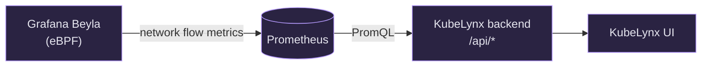

<p align="center">
  
</p>

<h1 align="center">KubeLynx</h1>

<p align="center">
  A lightweight Kubernetes network topology UI that turns Prometheus metrics and eBPF telemetry into real-time service-to-port traffic flows.
</p>

<p align="center">
  <a href="LICENSE"></a>
  
  
</p>

<p align="center">
  
</p>

## How it works

KubeLynx only reads telemetry that already exists. It doesn't scrape endpoints, create new metrics, or add agents or sidecars to your cluster.



Each node in the graph is a **workload**: a Deployment, ReplicaSet, DaemonSet or StatefulSet plus its namespace, as Beyla reports it. Nodes are never Kubernetes Services, because Beyla's flow metrics carry no Service identity. [CONTEXT.md](CONTEXT.md) has the full domain vocabulary.

## Features

- **Live topology.** Workloads are grouped into namespace bands. Traffic shows as moving dots along edges, and inbound ports appear as badges on each workload.
- **Filters.** Pick one or more namespaces, or narrow the graph to HTTP, gRPC or TCP traffic.
- **Layout.** Choose vertical, horizontal or automatic band arrangement. Dragged positions are remembered; **Rearrange** resets them.
- **Flows table.** Search flows by source or destination. Selecting one shows the PromQL query behind it.
- **Pause and resume** live refresh, and switch between **dark, light or system** themes.
- **Bounded cardinality.** TCP ports outside a known-ports allow-list, and UDP ports other than 53, are grouped into a single `multiple` flow.

## Development

Requirements: Go 1.26, Node.js with npm, Docker, [kind](https://kind.sigs.k8s.io/), kubectl and Helm.

1. Spin up the dev cluster (kind, Prometheus, Beyla and demo traffic):

   ```sh
   make setup
   ```

2. Port-forward Prometheus to `localhost:9090`:

   ```sh
   make port-prometheus
   ```

3. Run the backend (serves the API on `:8080`):

   ```sh
   go run ./cmd/kubelynx -prometheus-url http://localhost:9090
   ```

4. Run the frontend (proxies `/api` to the backend on `:8080`):

   ```sh
   cd web && npm install && npm run dev
   ```

Other make targets:

| Target | What it does |
| --- | --- |
| `make test` | Checks that Beyla flow metrics are reaching Prometheus |
| `make logs-beyla` | Tails the Beyla logs |
| `make clean` | Deletes the kind cluster |

### Backend flags

| Flag | Default | Description |
| --- | --- | --- |
| `-listen-addr` | `:8080` | Address to serve the API on |
| `-prometheus-url` | `http://localhost:9090` | Base URL of the Prometheus server to query |
| `-protocol-ports-file` | built-in defaults | JSON file overriding the HTTP/gRPC port classification, e.g. `{"http":["8081"],"grpc":["50052"]}` |
| `-tcp-port-allowlist-file` | built-in defaults | JSON file overriding the TCP known-ports allow-list, e.g. `{"tcp":["80","443","8080"]}` |

## Packaging

KubeLynx is planned to ship as a single container image, with the Go backend serving the embedded frontend. [ADR 0001](docs/adr/0001-single-image-packaging.md) explains why. The image and Helm chart don't exist yet.

## License

[Apache 2.0](LICENSE)
